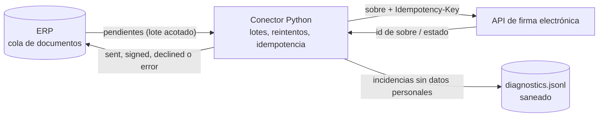
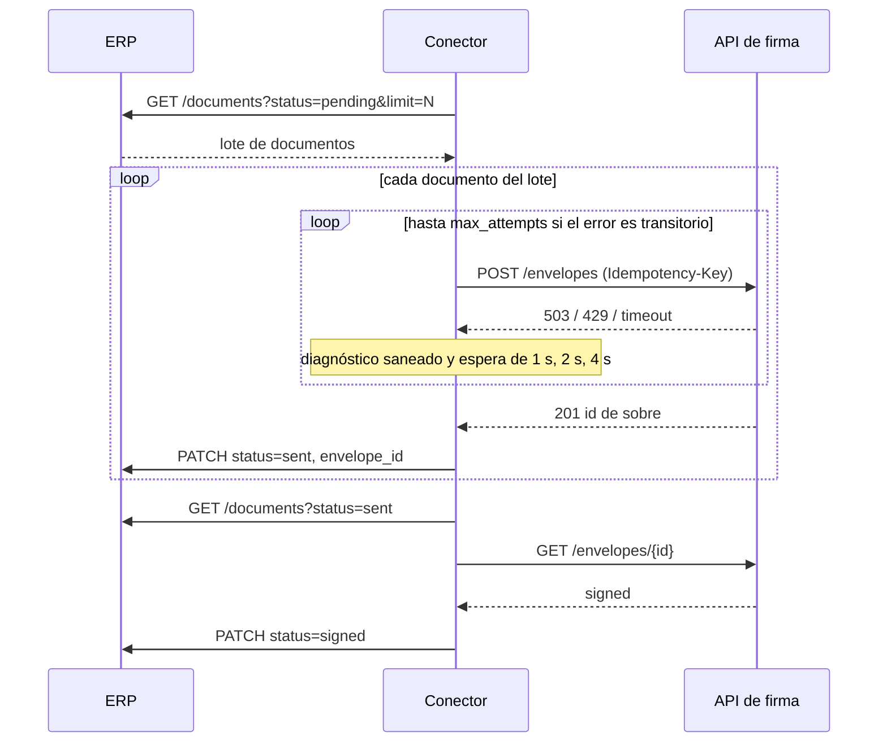

# erp-esignature-connector-demo


> **English summary.** Case study of an integration between an ERP and an e-signature platform. The ERP exports documents to a queue; a small Python connector processes that queue in bounded batches, sends each document to the signature API with retries and exponential backoff, uses idempotency keys so a resend never creates a duplicate envelope, stores diagnostics without personal data, and writes the signed status back to the ERP. Both the ERP and the signature provider are local fakes with mock data (Acme Corp, `example.com`). The `docs/` folder holds the project management side: WBS, RAID log, phased plan with a sandbox pilot, and ADRs. The rest of this repository is in Spanish.

Caso de estudio independiente. Todos los datos son ficticios: la empresa es Acme Corp, las personas son inventadas y los correos usan `example.com`. No hay claves reales ni llamadas a servicios externos.

## Qué hace

Muchas empresas generan contratos, pedidos o albaranes en su ERP y los firman en una plataforma de firma electrónica. Este repositorio muestra cómo diseñaría esa integración. El patrón sirve para ERPs como Business Central u Odoo y para cualquier proveedor de firma con API REST.

1. El ERP deja en una cola los documentos pendientes de firma.
2. El conector lee la cola en lotes de tamaño fijo, con un número máximo de lotes por ejecución.
3. Cada documento se envía a la API de firma con una clave de idempotencia. Los errores transitorios (timeout, 429, 5xx) se reintentan con espera exponencial hasta un máximo de intentos. Los errores permanentes, como un dato inválido, no se reintentan.
4. Cada incidencia queda en `diagnostics/diagnostics.jsonl` con campos fijos y el mensaje saneado, sin nombres, correos, DNI, teléfonos ni IBAN.
5. El conector escribe en el ERP el identificador del sobre y, cuando el proveedor lo confirma, el estado `signed` o `declined`. Lo que agota los reintentos queda en `error` para que lo revise una persona.

## Arquitectura



En la demo, el ERP y el proveedor de firma son servidores `http.server` que envuelven los fakes de `src/connector/fakes.py`. Los tests usan esos mismos fakes en memoria, sin red.

## Secuencia de una ejecución



## Cómo ejecutarlo

Con Docker, en tres comandos:

```bash
git clone https://github.com/Romen-Adama-Dev/erp-esignature-connector-demo.git && cd erp-esignature-connector-demo
docker compose up -d erp firma
docker compose run --rm connector
```

El proveedor falso devuelve 503 en las dos primeras peticiones, así que se ven los reintentos. El quinto documento no tiene correo de firmante y acaba en `error`. El estado del ERP se consulta con `curl -s localhost:8001/documents`. Una segunda ejecución no reenvía nada. `docker compose down` lo para todo.

Sin Docker, con Python 3.12, la CLI usa los fakes en memoria:

```bash
PYTHONPATH=src python -m connector run --dry-run   # qué se enviaría, sin enviar ni escribir
PYTHONPATH=src python -m connector run --backoff-base 0.1
uv run --with pytest pytest                       # tests
```

Parámetros: `--batch-size`, `--max-batches`, `--max-attempts`, `--backoff-base` y `--diagnostics`, o sus variables de entorno (`BATCH_SIZE`, `MAX_BATCHES`, `MAX_ATTEMPTS`, `BACKOFF_BASE`, `DIAGNOSTICS_PATH`). Si `ERP_URL` y `SIGN_URL` están definidas, el conector usa los clientes HTTP.

## Decisiones de diseño

El detalle está en [docs/decisiones.md](docs/decisiones.md). En resumen:

- Lotes acotados (`batch_size` por `max_batches`). Así una ejecución tiene duración y carga previsibles, y un pico de documentos en el ERP no se convierte en un pico de llamadas al proveedor, que suele limitar las peticiones por minuto. Lo que no cabe se procesa en la ejecución siguiente.
- Reintentos solo para errores transitorios y como mucho `max_attempts` (4 por defecto, con esperas de 1, 2 y 4 segundos). Si el proveedor sigue caído después de eso, insistir en la misma ejecución solo alarga el lote. El documento pasa a `error` con el motivo y alguien de administración decide si se reenvía, porque el fallo puede venir de un dato mal informado en el ERP.
- Clave de idempotencia derivada del documento: `sha256(id + hash del contenido)`. Si el conector cae después de enviar y antes de escribir en el ERP, el reenvío lleva la misma clave y el proveedor devuelve el sobre que ya existía. Una versión nueva del documento tiene otro hash y genera un sobre nuevo.
- Si el ERP no responde, la ejecución se aborta. Sin escritura de vuelta, seguir enviando dejaría sobres que el ERP desconoce.
- El estado de firma se consulta por sondeo. Un webhook obligaría a exponer un endpoint desde la red del ERP, y en el piloto no compensa. Queda como mejora para el despliegue.
- Los diagnósticos guardan campos fijos (documento, intento, tipo de error, mensaje) y el mensaje pasa por `sanitize()`, que enmascara patrones conocidos y el nombre del firmante. Los servidores falsos tampoco registran las peticiones, porque el cuerpo lleva datos personales.
- Solo biblioteca estándar. El conector necesita HTTP, JSON y logging, y `urllib` basta. Cada dependencia que no entra es una actualización menos en el servidor del cliente.

## Gestión del proyecto

La carpeta [docs/](docs/) recoge cómo se llevaría el proyecto: la [WBS](docs/wbs.md), el [registro RAID](docs/raid.md) para el paso a producción, el [plan por fases](docs/plan.md) con el piloto en sandbox y las [decisiones de arquitectura](docs/decisiones.md) en formato ADR.

Romén define la arquitectura y las especificaciones, revisa cada PR y hace el despliegue. Para acelerar la implementación orquesta agentes de IA a partir de esas especificaciones. El criterio de aceptación es el mismo para cualquier cambio: tests en verde, revisión de código y la WBS, el RAID y el plan actualizados en la misma PR.

## Qué demuestra

- Cómo convertir un proceso de negocio (firmar lo que sale del ERP) en una integración con modos de fallo explícitos: qué se reintenta, qué no y quién se entera.
- Protección de datos pensada desde el diseño del log, antes del primer incidente.
- Una puesta en producción planificada con piloto en sandbox, criterios de paso y un RAID con responsables.
- Código y documentación de gestión en el mismo repositorio, revisados en la misma PR.

## Estructura

```
src/connector/
  processor.py      lotes, reintentos, idempotencia y escritura de vuelta
  diagnostics.py    saneado y registro de incidencias
  http_clients.py   clientes urllib para el ERP y la API de firma
  fakes.py          ERP y proveedor de firma en memoria, datos de Acme Corp
  fake_servers.py   los mismos fakes servidos por HTTP para docker compose
  __main__.py       CLI
tests/              pytest, sin red
docs/               WBS, RAID, plan y ADR
```

## Licencia

MIT. Copyright (c) 2026 Romén Adama Caetano Ramírez.
