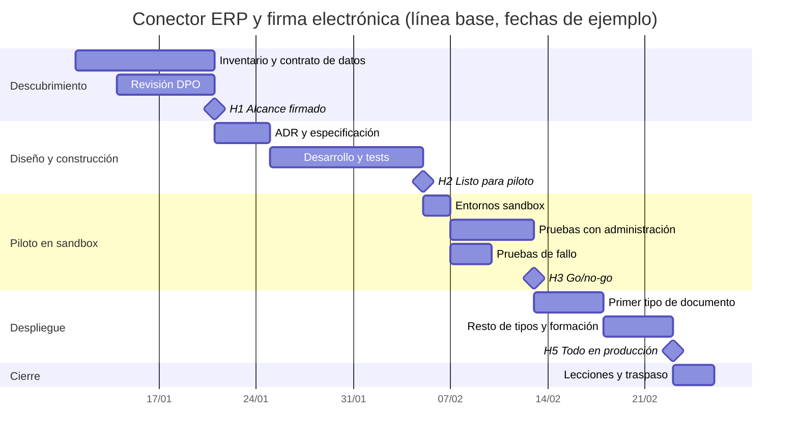

# Plan por fases

Plan base del caso de estudio. Las fechas son de ejemplo. El calendario vivo, con el avance real, las dependencias y los cambios de fecha, se gestiona en OpenProject; este documento y el diagrama son la línea base que se versiona con el código.

## Fases

Descubrimiento (semanas 1 y 2). Se inventarían los documentos que se firman, se revisan la API del proveedor y la forma en que exporta el ERP, y el DPO revisa el tratamiento de datos. Sale de esta fase el contrato de datos y el alcance firmado.

Diseño y construcción (semanas 3 a 5). Arquitectura en ADR, especificación con criterios de aceptación y desarrollo del conector con tests. Cada PR actualiza la WBS, el RAID y este plan si cambian.

Piloto en sandbox (semanas 6 y 7). El conector corre contra los sandbox del ERP y del proveedor con documentos anonimizados. Administración firma de punta a punta y se fuerzan fallos: proveedor caído, ERP lento, documento sin firmante.

Despliegue (semanas 8 y 9). Producción con un único tipo de documento durante una semana y después el resto. El conector arranca en `--dry-run` el primer día para comparar lo que enviaría con lo que administración espera.

Cierre (semana 10). Lecciones aprendidas y traspaso a soporte.

## Hitos

| Hito | Semana | Criterio |
|------|--------|----------|
| H1 Alcance firmado | 2 | Contrato de datos y alcance aprobados por Acme |
| H2 Conector listo para piloto | 5 | Tests en verde y revisión de código cerrada |
| H3 Go/no-go | 7 | Ver criterios de paso |
| H4 Primer tipo en producción | 8 | Una semana sin incidencias abiertas de severidad alta |
| H5 Todos los tipos en producción | 9 | Runbook entregado y formación hecha |

## Criterios de paso del piloto a producción

- Ningún sobre duplicado en las pruebas de caída.
- Los diagnósticos del piloto revisados sin datos personales.
- Todos los documentos del piloto en `signed`, `declined` o `error` con motivo; ninguno perdido en `sent` más de 24 horas sin explicación.
- Visto bueno del DPO (D3) y servidor de producción disponible (D4).
- Riesgos de impacto alto del RAID mitigados o aceptados por escrito.

## Diagrama de Gantt

